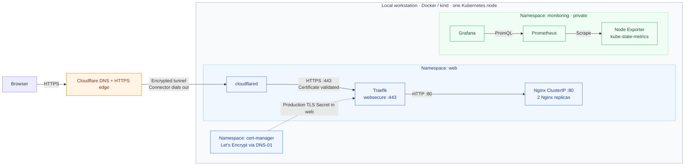
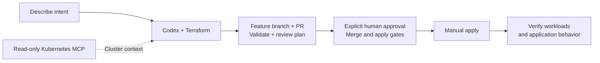
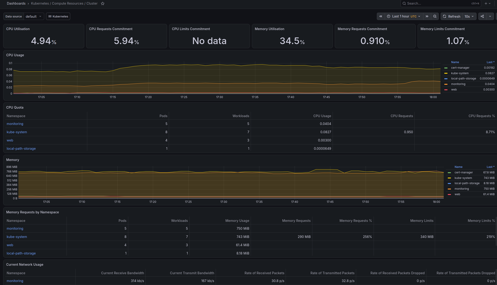
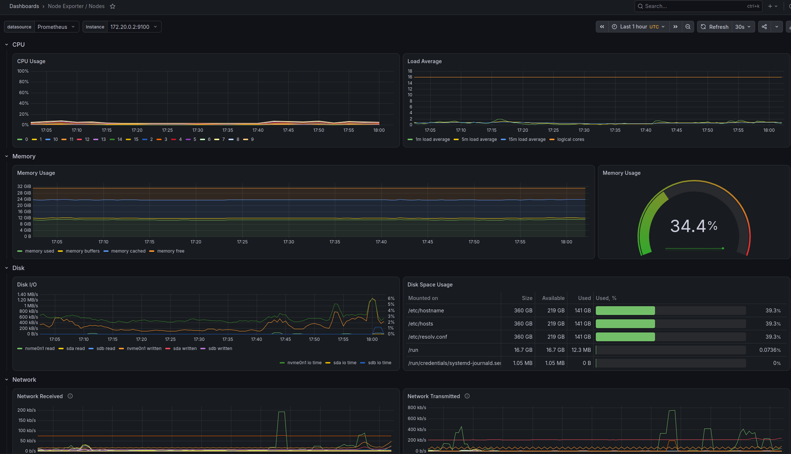
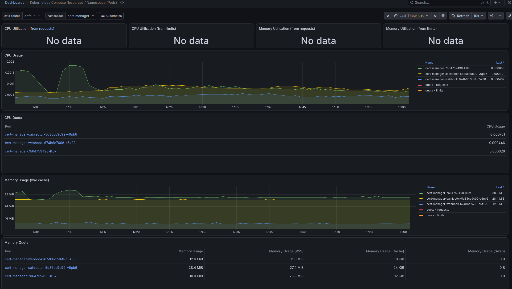
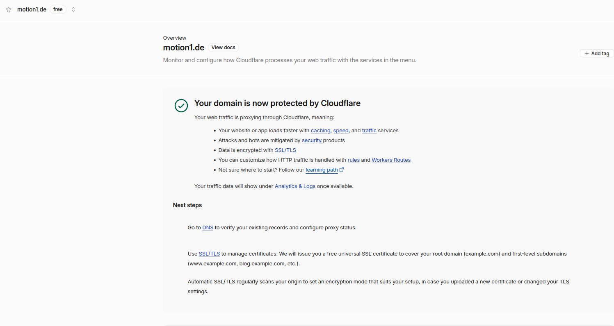
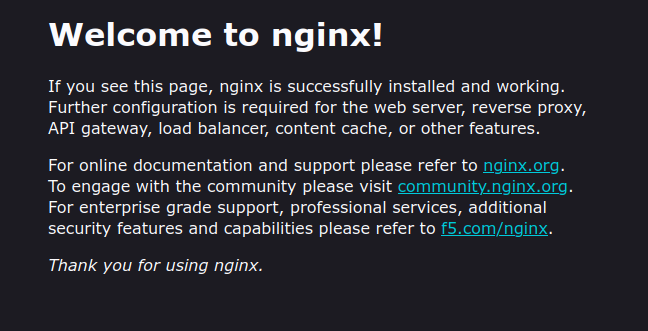
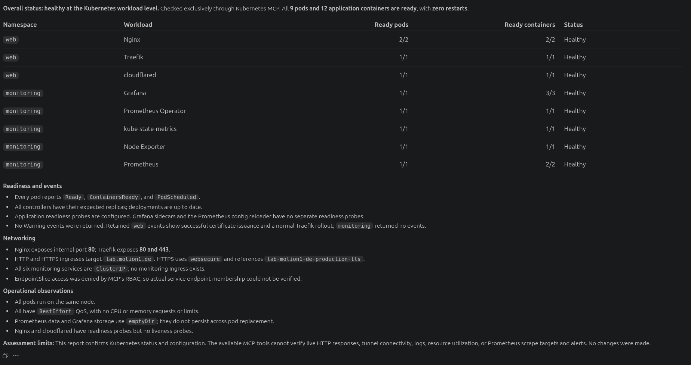

# Kubernetes Platform Lab

**Infrastructure as code. Validated HTTPS. Observable workloads. AI-assisted operations.**

A DevOps portfolio project that turns a local Kubernetes cluster into a public HTTPS service using Terraform, Helm and Cloudflare Tunnel. It demonstrates infrastructure delivery, operational verification and a read-only AI integration—with human approval before infrastructure changes.


[**Live demo ↗**](https://lab.motion1.de) · [Architecture](#architecture) · [Deployment guide — German](docs/deployment.md) · [Roadmap](#roadmap)

> **Locally hosted:** the demo runs on a local workstation through Cloudflare Tunnel. Availability depends on the workstation and connector. It serves the default Nginx page; the infrastructure is the portfolio deliverable.

## What this project demonstrates

| Area | Implemented capability |
|---|---|
| Infrastructure as code | Two small Terraform configurations: a single-node kind cluster and its applications, with pinned providers and committed lockfiles. |
| Application delivery | Two Nginx replicas behind a ClusterIP service and Traefik HTTP/HTTPS ingress. |
| Public access | Terraform-managed Cloudflare Tunnel and DNS, with no router port forwarding. |
| Certificate lifecycle | cert-manager with separate Let's Encrypt staging and production issuers, DNS-01 validation and a production TLS certificate. |
| Observability | Prometheus Operator, Prometheus, Grafana, Node Exporter and kube-state-metrics, accessed privately through local port forwarding. |
| AI-assisted operations | Codex in VS Code uses a local Kubernetes MCP server to inspect approved resources in `web` and `monitoring`. |

**Recorded verification — 27 November 2026:** public and local HTTPS returned HTTP/2 200 with valid certificates; both Nginx replicas were ready; Prometheus reported 12/12 scrape targets up. These are documented test results, not uptime or performance guarantees. [Validation records and commands →](docs/deployment.md#cloudflare-tunnel)

## Architecture



Cloudflare terminates browser TLS. Inside the cluster, cloudflared connects to `https://traefik.web.svc.cluster.local:443` and validates the origin certificate against **`lab.motion1.de`** (`no_tls_verify = false`). Traefik forwards HTTP to Nginx. Internal HTTP ingress remains available as a deliberate rollback option; TLS failures do not trigger an automatic downgrade.

cert-manager uses Cloudflare DNS-01 validation with separate staging and production issuers. The monitoring stack has no public Ingress. Kubernetes MCP runs locally over stdio, using a separate ServiceAccount and kubeconfig.

## AI-assisted infrastructure workflow



Codex helps prepare changes and explain plans. The MCP server, [`containers/kubernetes-mcp-server`](https://github.com/containers/kubernetes-mcp-server), provides read-only cluster context. Merge and apply are separate approval steps; the current workflow is manual. GitHub Actions validation is still on the roadmap.

## Security by design

| Control | Implementation |
|---|---|
| Least privilege | Dedicated MCP ServiceAccount; `get` and `list` only for selected resource types, scoped by RoleBindings to `web` and `monitoring`. No Secrets, pod exec, pod logs or writes. |
| Credential separation | MCP uses its own kubeconfig with a short-lived ServiceAccount token, never the administrator kubeconfig. Cloudflare DNS-01 uses a separate API token. |
| TLS validation | Public HTTPS, an encrypted Cloudflare tunnel and validated origin HTTPS using the Let's Encrypt production certificate. |
| Secret management | Cloudflare API credentials come from environment variables. Kubernetes Secret writes use write-only attributes; the DNS-01 token variable is ephemeral. cert-manager manages certificate keys in Kubernetes. |
| Local secret protection | Kubeconfigs, state and saved plans are excluded from Git. Sensitive local files use mode `0600`; the tunnel token can still be present in Terraform state and plans. |
| Change control | Reviewed feature branches, inspected Terraform plans and explicit approval before merge or apply. Providers and charts are pinned; Nginx, Traefik, cloudflared and the kind node image also use digests. |

## Monitoring & observability

The `kube-prometheus-stack` Helm release provides cluster, node and workload dashboards. The screenshots below are from the actual lab. They show captured observations rather than benchmark results; some request/limit panels show **“No data”** where those resource settings are absent.

[](docs/images/grafana-cluster.png)

<details>
<summary><strong>Explore node and workload dashboards</strong></summary>

**Node view:** CPU, load, memory, disk and network metrics from Node Exporter.

[](docs/images/grafana-node.png)

**Workload view:** CPU and memory usage for the cert-manager pods.

[](docs/images/grafana-workloads.png)

</details>

Prometheus retains metrics for 24 hours. Prometheus and Grafana use temporary storage, and Alertmanager is disabled. This is a single-node learning environment; persistent monitoring storage and high availability are outside the current implementation. [Local access and operational notes →](docs/deployment.md#lokales-monitoring)

<details>
<summary><strong>View delivery evidence: Cloudflare, website and Kubernetes MCP</strong></summary>

**Cloudflare:** domain overview showing proxied traffic for `motion1.de`.

[](docs/images/cloudflare.png)

**Website:** the Nginx page served by the demo.

[](docs/images/website.png)

**Kubernetes MCP:** a read-only workload health report for `web` and `monitoring`, including the assessment limits imposed by RBAC.

[](docs/images/kubernetes-mcp.png)

</details>

## Repository structure

```text
.
├── README.md                    # Portfolio overview
├── cluster/
│   ├── main.tf                  # Single-node kind cluster
│   └── .terraform.lock.hcl       # Cluster provider versions and checksums
├── apps/
│   ├── main.tf                  # Workloads, tunnel, TLS, monitoring and MCP RBAC
│   └── .terraform.lock.hcl       # Application provider versions and checksums
├── .codex/
│   ├── config.toml              # Project-local Codex MCP integration
│   └── kubernetes-mcp.toml      # Read-only tools and Secret access restrictions
├── .gitignore                   # Keeps local credentials, state and plans out of Git
└── docs/
    ├── deployment.md            # Full technical guide and validation history (German)
    └── images/                  # Six reviewed screenshots from the running lab
```

For exact versions, required environment variables, installation ordering, port-forward commands, TLS checks and MCP setup, see the **[deployment guide](docs/deployment.md)**. It preserves the previous technical README, including its project rules and verification history. Run its commands from the repository root.

## Roadmap

- [x] Remove the old infrastructure and initialize Git.
- [x] Provision the local Kubernetes cluster with Terraform.
- [x] Deploy two Nginx replicas, a ClusterIP service and Traefik ingress.
- [x] Delegate the domain to Cloudflare and manage tunnel + DNS through Terraform.
- [x] Issue Let's Encrypt staging and production certificates with DNS-01.
- [x] Enable Traefik HTTPS and fully validated Cloudflare origin TLS.
- [x] Deploy private Prometheus and Grafana monitoring.
- [x] Integrate a local Kubernetes MCP server with read-only RBAC.
- [ ] Add GitHub Actions for code validation.
- [ ] Verify a complete infrastructure teardown and rebuild.
